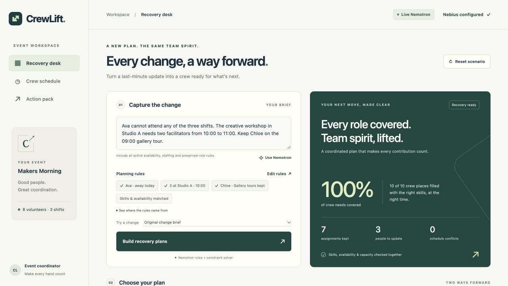

# CrewLift

**Every change. A stronger plan.**

CrewLift turns a plain-language event update into two calculated staffing plans and a complete action pack. **NVIDIA Nemotron through Nebius Token Factory** interprets the change; CrewLift validates the planning rules, optimizes the roster, and prepares clear personal handoffs.

[Watch the 2:42 demo](video/final/crewlift-narrated-demo.mp4) · [Run locally](#run-locally) · [Verified results](submission/verification_summary.md) · [Project story](submission/project_story.md)

| Required places covered | Original assignments retained | People to update |
| :---: | :---: | :---: |
| **10 / 10** | **7** | **3** |



In the verified live **Makers Morning** demonstration, using fictional event data, CrewLift covers **10 of 10 required places**, preserves **seven original assignments**, and updates **three people's plans**—the smallest affected crew compatible with full coverage in this scenario. The coordinator accepts revision one and exports a matching roster CSV, structured JSON plan and personal handoff brief.

The recorded product checks pass **95 independent solver cases**, **24 development tests**, and **10 HTTP workflow groups**. A separate local continuation test verifies a second accepted revision with full coverage and correct personal updates. Explore the [live browser verification](evidence/live/final-ui-independent-verification.json), [achievement summary](submission/achievement_claims.md) and [verification methods and results](submission/verification_summary.md).

## Verified NVIDIA workflow

1. Enter the event change in everyday language.
2. NVIDIA Nemotron extracts structured planning rules and exact supporting passages from the brief.
3. CrewLift validates the rules and computes **Keep the rhythm** and **Share the energy**.
4. Review the roster and personal changes, then accept the chosen plan.
5. Download the versioned action pack with roles, rooms, times and change reasons.

The provider-returned model is `nvidia/Nemotron-3_5-Lightning`. Both the [isolated live acceptance](evidence/live/verification-2026-10-23T16-50-14.475Z.json) and the [final browser run](evidence/live/final-ui-independent-verification.json) verify the full path. The browser run's exported [action brief](evidence/live/final-ui-accepted-r1-handoff.txt), [CSV roster](evidence/live/final-ui-accepted-r1-plan.csv) and [JSON plan](evidence/live/final-ui-accepted-r1-plan.json) match its accepted revision.

## Run locally

Node.js 22 or newer is the only application dependency. No package install or build step is needed.

```sh
npm start
```

Open `http://127.0.0.1:4187`. The app serves the fictional **Makers Morning** event, with eight volunteers and three one-hour shifts. Structured controls immediately run the real local solver.

To use a different local port:

```sh
PORT=4188 npm start
```

## Connect Nebius Token Factory

Create a local `.env` from `.env.example` and enter your authorized `NEBIUS_API_KEY` there. The file is ignored by Git. Restart the server after configuration. Keep credentials out of chat, browser code, screenshots and exports.

The live adapter calls `nvidia/Nemotron-3_5-Lightning` at Nebius Token Factory's global OpenAI-compatible endpoint. It converts a change brief into constraints and exact source passages. Each brief supplies the complete set of active changes; CrewLift keeps the event’s base requirements. Include all active availability, staffing and preserved-role changes. The user reviews those constraints before accepting a roster. Live responses include the model identifier, inference duration and returned token usage. Sample-mode responses have `model: null` and `usage: null` and make no inference request.

The live verification script confirms provider identity, complete source clauses, the recovered roster and matching exports in one workflow. The adapter's request and validation boundaries also have offline tests.

## Deploy

The [Vercel deployment guide](DEPLOYMENT.md) covers the public API, persistent per-browser sessions, server-only model configuration and bounded inference requests. The deployment adapter has [verified durable-storage behavior](evidence/deployment/store-verification.json) for independent sessions, concurrent updates and request accounting.

## How recovery works

1. A structured edit or live model extraction produces a complete replacement constraint set.
2. Validation accepts only known volunteer, task, skill and slot IDs. Every model-derived constraint requires an exact source passage from the supplied brief.
3. The solver respects skills, declared availability, one assignment per person per time slot, maximum shift counts and preserved assignments.
4. Both plans maximize coverage. **Keep the rhythm** then minimizes the number of people whose task sets change, including people initially on standby. It next retains assignments. **Share the energy** minimizes the sum of squared shift counts, then retains assignments.
5. The coordinator accepts one complete plan. Its assignments become the next baseline, with an incremented session revision. Subsequent changes are compared with that accepted baseline. Stale plans cannot replace a newer accepted revision.
6. JSON, CSV and a readable handoff brief export the selected plan. JSON contains the scenario, constraints, source map, exact assignment data, metrics and input/output fingerprints. The brief includes each affected volunteer's before/after locations and times.

The eight-person scenario uses exact enumeration of the people allowed to change, followed by integral minimum-cost maximum flow. Each returned roster receives a separate constraint audit. This implementation supports discrete, non-overlapping, equal one-hour slots. Maximum-shift limits express capacity in this scenario.

All sample people and event details are fictional. The standalone local workspace keeps revisions and runs in memory; reset restores the original event and restart begins a new session. The public deployment adapter uses durable per-browser sessions, as described in the deployment guide.

## API

| Method | Route | Purpose |
| --- | --- | --- |
| GET | `/api/config` | Model name, live credential-presence boolean, current revision |
| GET | `/api/health` | Alias for configuration/readiness |
| GET | `/api/scenario` | Current accepted baseline and full editable constraints |
| POST | `/api/plan` | `{mode: "sample", constraints}` or `{mode: "live", brief}` |
| POST | `/api/accept` | `{runId, planId}`; accept complete coverage and advance the baseline |
| POST | `/api/reset` | `{}`; reset the local session |
| POST | `/api/export` | `{runId, planId, format: "json" | "csv" | "brief"}` |

Constraint fields are `unavailable`, `demand`, `locked`, `skillRequirements` and `capacity`. Arrays replace the current constraint set in full; omissions normalize to empty arrays. Omitting the entire `constraints` field reuses the currently accepted set. The frontend retains its whole editable set when submitting changes.

The sample fixture documents every object shape. Requests are limited to 32 KB. API errors return `{error: {code, message}}`. The server binds to `127.0.0.1`, validates write origins, keeps the inference credential server-side and permits only the fixed Nebius inference destination.

## Verify

```sh
npm test
```

The targeted suite covers constraint validation, preservation and capacity rules, infeasible demand, independent assignment auditing, model-source validation, missing-key behavior, the inference adapter with mock transport, revision acceptance, stale revision rejection, reset and three export formats.

Independent validation scripts and their evidence are maintained under `scripts/` and `evidence/`. Live model evidence, final browser captures and matching exports are in `evidence/live/`. The [verification summary](submission/verification_summary.md) connects each result to its supporting artifact.

## Sources

- [Nebius Token Factory quickstart](https://docs.tokenfactory.nebius.com/quickstart)
- [Official NVIDIA Nemotron cookbook](https://github.com/nebius/token-factory-cookbook/tree/main/models/nemotron)
- [Public model catalog](https://tokenfactory.nebius.com/api/public/models_info)
- [Structured output documentation](https://docs.tokenfactory.nebius.com/ai-models-inference/json)

## License

The application source uses the [MIT license](LICENSE). The demonstration's openly licensed narration is documented in [voice attribution and sources](video/final/voice-license/README.md).
